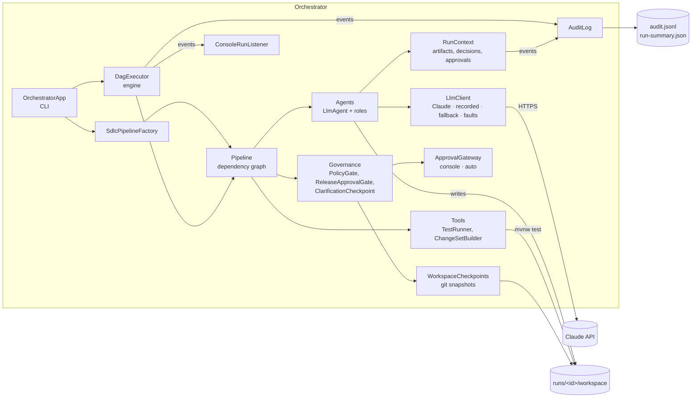
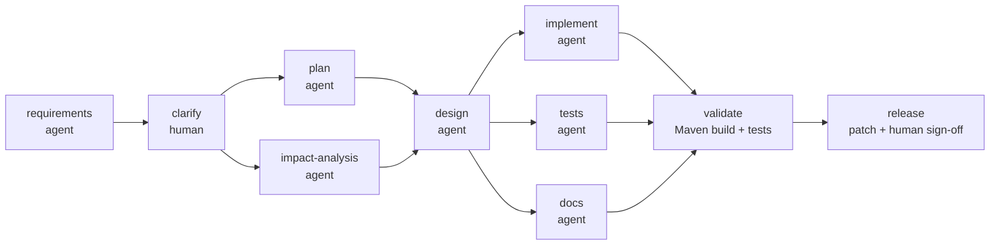
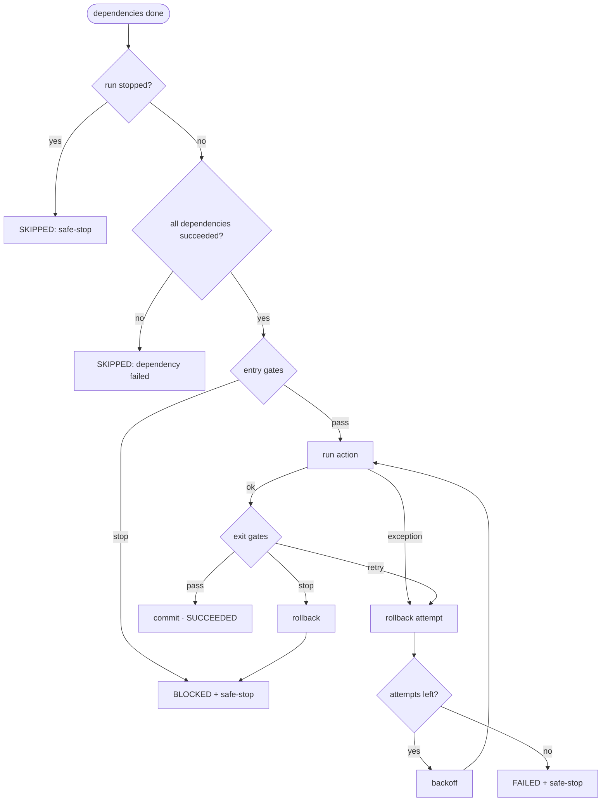

# Architecture

## Overview

Two modules:

- **orchestrator**: the agentic system. Plain Java 25, no framework. It takes a requirement, runs agents and deterministic tools through an explicit dependency graph, and governs every step.
- **shortener**: a Spring Boot 4 URL shortener. It is the system the agents build (greenfield) or change (brownfield, ambiguous).

The orchestrator never edits the real repository. Each run copies the code into `runs/<run-id>/workspace/` and ends with a patch a human approves.



## The pipeline



| Stage | Kind | Reads | May write | Governance |
|-------|------|-------|-----------|------------|
| requirements | agent | requirement | — | 3 attempts |
| clarify | human checkpoint | requirements' questions and assumptions | — | accept / answer (re-runs requirements) / reject |
| plan | agent | requirements | — | 3 attempts |
| impact-analysis | agent | requirements, code | — | 3 attempts |
| design | agent | requirements, plan, impact-analysis, code | — | 3 attempts |
| implement | agent | requirements, design, code | `shortener/src/main` | 3 attempts, policy gate, rollback |
| tests | agent | requirements, design, code | `shortener/src/test` | 3 attempts, policy gate, rollback |
| docs | agent | requirements, design | `docs` | 3 attempts, policy gate, rollback |
| validate | tool | workspace | — | 1 attempt, final secret scan, full rollback on failure |
| release | tool | workspace | `changes.patch` | human approval: approve / reject / revise |

Waves: stages whose dependencies are all done run together. `plan` ∥ `impact-analysis`, and `implement` ∥ `tests` ∥ `docs`, run in parallel; `design` and `validate` are synchronization points.

`implement` and `tests` both work from the design and cannot see each other's output, so the tests check the design's contract rather than whatever the code happens to do. If they disagree, validation catches it.

## Orchestration model

### Engine (`engine/`)

Generic: it knows nothing about agents, git or LLMs.

- **`Pipeline`**: an explicit DAG, validated when built (unknown or duplicate stages, self-dependencies and cycles are rejected; Kahn's algorithm). Provides topological order, waves, and `downstreamOf(stage)` for re-planning.
- **`DagExecutor`**: each stage is a `CompletableFuture` that waits on `allOf(its dependencies)`, then runs on a virtual thread. Independent stages run in parallel; a stage with several dependencies waits for all of them.
- **`StageControls`** per stage: max attempts, backoff, entry gates, exit gates, and a `RollbackHandler` (`commit` on success, `rollback` on a failed or rejected attempt).
- **`Gate`** returns `PASS`, `RETRY` (undo this attempt, try again if attempts remain) or `STOP` (undo, safe-stop the run). A gate that throws counts as `STOP`: when a check itself is broken, the engine does not guess.
- **Safe-stop**: when a stage fails for good or a gate stops it, no new stage starts; stages already running finish; everything else is reported as skipped with the reason.
- **`rerun(pipeline, previousReport, changedStage)`**: re-planning. Re-runs the changed stage and everything downstream of it; reuses the results of every other stage that succeeded.
- **`RunListener`**: every event (started, gate failed, retrying, rolled back, finished, safe-stop, re-planning) goes to listeners: the console and the audit log.

### Control flow of one stage



### Agents (`agent/`)

`LlmAgent` holds the shared steps: build the prompt (requirement, upstream artifacts, optional code snapshot, human feedback), call the model, parse the answer, write files inside the agent's allowed folders, record the artifact and decisions. Each role (`agent/roles/`) only declares its job, what it reads, and where it may write.

Agents answer in a plain-text format (`SUMMARY:`, `DECISION: … | BECAUSE: …`, `ASSUMPTION:`, `QUESTION:`, `<<<FILE path … >>>`). Plain text rather than JSON, because code inside JSON strings needs escaping that models get wrong. A malformed answer fails the attempt and is retried.

**Autonomy boundary, enforced in code**: a write outside the agent's folders, an absolute path or a `../` escape is rejected before anything is written.

### Context and decision lineage (`run/RunContext`)

Shared, thread-safe state of a run: every stage's artifact, the decision log, policy findings, approvals and human feedback. Later stages read earlier artifacts; that is how context crosses stages. Each decision records which stage made it, why, and which upstream stages it was based on, e.g. `[design] Return 410 Gone ← requirements, plan, impact-analysis`.

### Governance (`governance/`)

Policies inspect the files a stage **actually changed on disk** (from the workspace's git snapshots), not what the agent says it did.

| Policy | Kind | Severity |
|--------|------|----------|
| `security/secret-scan` | security | block |
| `compliance/test-integrity` (no deleted, disabled or removed tests) | compliance | block |
| `compliance/dependency-change` (pom.xml) | compliance | human approval |
| `change-control/db-migration` (*.sql) | change control | human approval |
| `change-control/blast-radius` (> 15 files in one stage) | change control | human approval |
| `change-control/release` | change control | human approval |
| `governance/requirements-clarification` | requirements | human answer or acceptance |

A block rejects the attempt (rolled back, retried); a rejected approval stops the run. Approvals go through an `ApprovalGateway`: the console (interactive) or automatic (`--auto-approve`, recorded as `auto` so the audit trail shows no human looked). The release prompt can also send any stage back with feedback, which triggers re-planning.

### Rollback (`run/WorkspaceCheckpoints`)

The workspace is its own git repository. The baseline (before any agent ran) is the first commit; each accepted stage is committed. Stages write disjoint folders, so rolling back one stage restores only its folders and never touches parallel stages' work. A failed validation resets the whole change set to the baseline. The release patch is `git diff baseline HEAD`.

### Model boundary (`llm/`)

```
FallbackLlmClient(primary = FaultInjectingLlmClient?(ClaudeLlmClient | ScriptedLlmClient),
                  fallback = ScriptedLlmClient)
```

- `ClaudeLlmClient`: official Anthropic Java SDK, streaming, `claude-opus-5-5` by default, server-side refusal fallback enabled. The key is read from the environment only.
- `ScriptedLlmClient`: recorded responses per scenario and agent (plus an optional `.revised` answer used after human feedback).
- `FallbackLlmClient`: per-agent circuit breaker; after 2 failures that agent uses the recorded response.
- `FaultInjectingLlmClient`: chaos testing on demand (`--inject-fault`).

### Observability (`observability/`)

- `AuditLog` receives engine events (as a `RunListener`) and governance events (as the context's `AuditSink`) and appends each as one JSON line to `audit.jsonl` immediately. Every line carries the SHA-256 of the previous line; `--verify-audit` recomputes the chain and reports the first changed or removed event.
- At the end of a run it writes `run-summary.json`. `--metrics` aggregates all summaries: success rate, retry frequency (retries / stage executions), rollback frequency, fallbacks, MTTR (first failed attempt → success, unrecovered failures counted separately), and end-to-end latency (p50/p95/max) both with and without human approval wait.

## Key decisions

| Decision | Why |
|----------|-----|
| Orchestrator built from scratch, not on a workflow engine | The orchestration is what is being evaluated; every mechanism is visible, small and unit-tested. In production the same model would run on Temporal (durable state, distributed workers). |
| Deterministic tools for validation and release | Agents propose; a real build, real tests and policies decide. |
| Governance inspects the actual file changes | An agent cannot talk its way past a policy. |
| Work on a copy, release as a patch | The real code is never touched until a human applies an approved patch. |
| Mock at the model boundary | Mock runs exercise all of the orchestration code; only the model's reply is recorded. |
| Git for checkpoints | Precise per-folder rollback and an exact, applicable patch, using a tool everyone already has. |
| Plain-text agent output format | Whole files survive without JSON escaping; recorded responses stay readable. |
| Approval wait measured separately | A slow approver must not look like a slow pipeline. |
